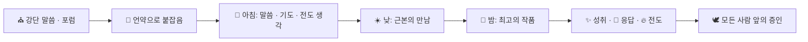

# 📖 말씀 · 기도 · 전도 — 언약 증인 일지

> 오직 성령이 너희에게 임하시면 너희가 권능을 받고
> 예루살렘과 온 유대와 사마리아와 땅 끝까지 이르러 **내 증인이 되리라** — 사도행전 1:8

강단을 통해 선포되는 말씀을 **언약**으로 붙잡고,
아침마다 **말씀 · 기도 · 전도**를 생각하며,
낮에 주시는 **근본의 만남**과 밤에 남기게 하시는 **최고의 작품**을 기록합니다.

매년 · 매달 · 매주 · 매일 쌓이는 이 기록이
하나님의 말씀이 나의 삶에서 **성취**되고, 기도가 **응답**되며,
나의 삶을 통해 **전도 역사**가 일어나는 것을 모든 사람 앞에 보여주는 **증인의 기록**이 되기를 소망합니다.

---

<!-- DASHBOARD:START -->
### ✏️ 오늘 기록하기

**[✏️ 2026-11-22 (주일) 오늘의 기록 쓰기](https://github.com/lukaschoi970315/covenant-witness-journal/edit/main/records/2026/11/2026-11-22.md)** · [📄 보기](records/2026/11/2026-11-22.md) · [⛪ 이번 주 강단 말씀 · 포럼 쓰기](https://github.com/lukaschoi970315/covenant-witness-journal/edit/main/records/2026/11/2026-11-22-week.md)

### 📊 지금까지의 증인 기록

| 📅 기록한 날 | 🔗 연속 기록 | 📖 언약 | 🤝 만남 | 🌙 작품 | ✨ 성취 | 🙏 응답 | 🔥 전도 |
|:-:|:-:|:-:|:-:|:-:|:-:|:-:|:-:|
| **0일** | **0일** | [0](witness/covenant.md) | [0](witness/encounters.md) | [0](witness/masterpieces.md) | [0](witness/fulfillment.md) | [0](witness/prayer-answers.md) | [0](witness/evangelism.md) |

### 🕊️ 최근 기록

_첫 기록을 기다리고 있습니다. 오늘부터 시작합니다!_ 🙏

### 📅 [2026년](records/2026/README.md) 월별 기록한 날

| 1월 | 2월 | 3월 | 4월 | 5월 | 6월 | 7월 | 8월 | 9월 | 10월 | [11월](records/2026/11/README.md) | 12월 |
|:-:|:-:|:-:|:-:|:-:|:-:|:-:|:-:|:-:|:-:|:-:|:-:|
| · | · | · | · | · | · | · | · | · | · | · | · |
<!-- DASHBOARD:END -->

---

## 🕊️ 하루의 흐름



## 📚 증인의 기록 모음 (자동 정리)

| | 모음 | 무엇이 모이나요 |
|:-:|---|---|
| 📖 | [붙잡은 언약](witness/covenant.md) | 강단 말씀에서 붙잡은 나의 언약 |
| 🤝 | [근본의 만남](witness/encounters.md) | 낮에 하나님이 예비하신 만남 |
| 🌙 | [최고의 작품](witness/masterpieces.md) | 밤에 남기게 하신 최고의 작품 |
| ✨ | [성취된 말씀](witness/fulfillment.md) | 말씀이 나의 삶에서 이루어진 기록 |
| 🙏 | [기도 응답](witness/prayer-answers.md) | 기도하고 응답받은 기록 |
| 🔥 | [전도 역사](witness/evangelism.md) | 나의 삶을 통해 하신 전도 역사 |

## 🏷️ 기록 표시 — 이것만 기억하세요

날짜별 기록에 아래처럼 **`표시::`** 를 붙여 한 줄로 적으면 위의 모음과 대시보드에 자동으로 모아집니다.

| 표시 | 언제 | 예시 |
|---|---|---|
| `언약::` | 🌅 아침 | `언약:: 마 28:20 세상 끝날까지 너희와 항상 함께 있으리라` |
| `만남::` | ☀️ 낮 | `만남:: 점심에 동료 K와 말씀 나눔, 마음 문이 열림` |
| `작품::` | 🌙 밤 | `작품:: 가정 예배에서 자녀와 오늘의 언약을 나눔` |
| `성취::` | 언제든 | `성취:: 아침에 붙잡은 '함께하심'을 회의 중 체험` |
| `응답::` | 언제든 | `응답:: (11/3 기도) 막혔던 계약이 오늘 열림` |
| `전도::` | 언제든 | `전도:: 이웃 P님께 복음 전함, 다음 주 함께 예배 약속` |

## 🗂️ 구조 — 매년 · 매달 · 매주 · 매일

```
records/
└── 2026/
    ├── README.md               ← 📆 매년: 올해의 언약 · 월별 현황 (자동 표)
    └── 11/
        ├── README.md           ← 🗓️ 매달: 이달의 언약 · 날짜별 표 (자동)
        ├── 2026-11-22-week.md  ← ⛪ 매주: 주일 강단 말씀 · 포럼 · 주간 결산
        └── 2026-11-22.md       ← 📖 매일: 아침 · 낮 · 밤 기록
witness/                        ← 🕊️ 증인 기록 모음 (자동 생성)
templates/                      ← 매일 · 매주 · 매달 · 매년 양식
scripts/journal.py              ← 페이지 생성 · 자동 정리 도구
```

## 🤖 자동으로 되는 일

- **매일 새벽 4시 (LA 시간)** — 오늘의 기록 페이지가 자동으로 생성됩니다. (주일엔 주간, 1일엔 월간, 1월 1일엔 연간 페이지도)
- **기록을 올릴 때마다** — 증인 기록 모음, 위 대시보드, 주간 · 월간 · 연간 표가 자동으로 정리됩니다.

## 📱 기록하는 방법

👉 **[기록 가이드 (휴대폰 · 웹 · 컴퓨터)](docs/GUIDE.md)**
